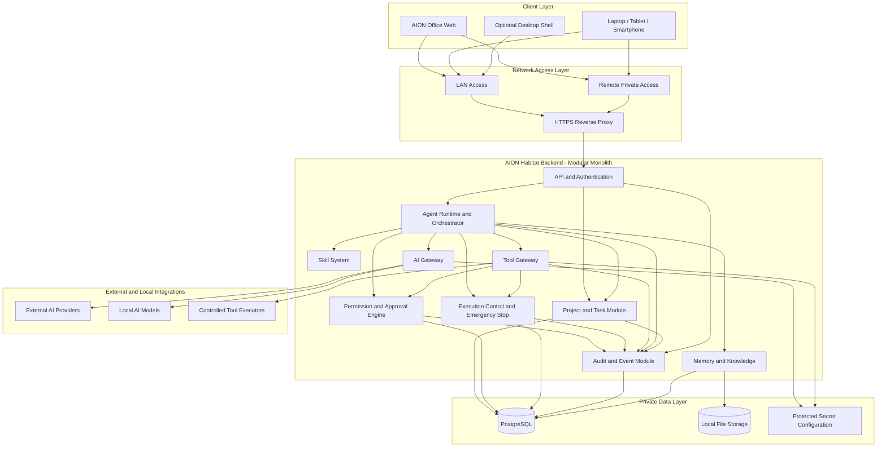

# KAME AION HABITAT

## System Architecture

**Product:** AION Habitat  

**Interface:** AION Office  

**Slogan:** The Living AI Office  

**Document ID:** KAH-ARCH-001  

**Version:** 0.1.0  

**Status:** DRAFT  

**Stage:** 12.2 - System Architecture  

**Related Document:** `docs/specifications/PRODUCT-REQUIREMENTS-BASELINE.md`

---

## 1. Purpose

Dokumen ini mendefinisikan rancangan arsitektur tingkat sistem untuk KAME AION HABITAT.

Arsitektur menjadi pedoman untuk membangun AION Habitat sebagai platform AI Agent Office yang mendukung banyak agent spesialis, supervised autonomy, pengelolaan task dan project, integrasi model AI, pengendalian tools, skills, memory, serta akses melalui LAN dan internet.

Dokumen ini merupakan rancangan konseptual. Komponen yang dijelaskan belum dianggap sudah diimplementasikan atau memiliki enforcement Runtime.

## 2. Architecture Goals

Arsitektur harus memenuhi tujuan berikut:

1. Mendukung banyak AI agent dengan spesialisasi dan tanggung jawab berbeda.

2. Memisahkan tanggung jawab antarmodul secara jelas.

3. Mempertahankan kontrol pengguna atas tindakan agent.

4. Menyediakan jalur eksekusi tools yang melewati pemeriksaan permission.

5. Mendukung model AI lokal dan API eksternal melalui satu abstraksi.

6. Menyimpan project state, task state, approval, dan audit events secara persisten.

7. Mendukung akses LAN dan akses jarak jauh yang aman.

8. Mengutamakan penggunaan resource yang efisien.

9. Memungkinkan pengembangan modular tanpa memerlukan microservices sejak awal.

10. Memungkinkan pemisahan komponen di masa depan apabila kebutuhan operasional membenarkannya.

## 3. Architecture Style

### 3.1 Owner-Confirmed Initial Architecture Baseline

Baseline arsitektur awal KAME AION HABITAT adalah **Modular Monolith dengan pendekatan Local-First**.

Baseline ini dikonfirmasi oleh Owner pada 19 November 2026 melalui persetujuan dalam percakapan proyek. Konfirmasi ini menetapkan arah arsitektur awal sebagai pedoman pengembangan, bukan persetujuan otomatis terhadap seluruh keputusan teknis, implementasi, atau status produksi.

Aplikasi utama berjalan sebagai satu deployment backend dengan batas modul internal yang jelas.

Setiap modul memiliki tanggung jawab, antarmuka, dan aturan dependensi sendiri. Komunikasi antarmodul menggunakan interface internal yang ditentukan, bukan akses bebas terhadap implementasi modul lain.

### 3.2 Meaning of Local-First

Local-First berarti sistem mengutamakan kendali lokal atas aplikasi, data, konfigurasi, dan penyimpanan.

Prinsip ini mencakup:

- Pengembangan dan pengoperasian awal mengutamakan lingkungan lokal yang dikuasai Owner.
- Data utama dan file proyek dikelola melalui penyimpanan yang berada dalam kendali sistem.
- Integrasi layanan AI eksternal dapat digunakan melalui AI Gateway tanpa memindahkan kendali aplikasi dan kebijakan data kepada provider.
- Akses LAN dan internet jarak jauh tetap didukung dengan autentikasi, otorisasi, dan perlindungan komunikasi yang sesuai.
- Local-First tidak berarti offline-only, tidak boleh menggunakan API eksternal, atau melarang penggunaan layanan cloud yang disetujui.

### 3.3 Reasons

- Lebih sederhana untuk dikembangkan dan dioperasikan.
- Mengurangi overhead jaringan dan infrastruktur.
- Cocok untuk perangkat pengembangan dengan sumber daya terbatas.
- Mempermudah debugging dan pengujian integrasi.
- Menjaga peluang pemisahan modul menjadi service independen di masa depan.
- Mempertahankan kendali lokal atas data dan konfigurasi penting.

### 3.4 Architectural Constraints

- Tidak menggunakan microservices sebagai kebutuhan awal.
- Tidak menambahkan message broker atau container orchestration tanpa kebutuhan yang terbukti.
- Modul tidak boleh melewati batas keamanan hanya karena berada dalam proses backend yang sama.
- Pemisahan modul secara logis harus tetap dijaga meskipun deployment masih satu aplikasi.
- Perubahan terhadap baseline memerlukan alasan, analisis dampak, review, dan persetujuan Owner sesuai governance proyek.

## 4. High-Level System Architecture

Diagram ini menggambarkan batas tanggung jawab konseptual. Kotak bukan berarti setiap komponen harus menjadi proses atau service terpisah.

## 5. System Components

### 5.1 AION Office Web

Tanggung jawab:

- Dashboard sistem.

- Agent directory dan agent detail.

- Project dan task management.

- Execution monitoring.

- Approval queue.

- Audit viewer.

- Provider dan tool configuration.

- Skill management.

- Memory dan knowledge interface.

- Virtual Office 2D.

Frontend tidak boleh menjadi tempat enforcement permission. Semua keputusan otorisasi harus diperiksa backend.

Frontend hanya menampilkan dan mengirimkan permintaan. Frontend tidak dapat menetapkan permission, menyetujui approval, atau melewati kebijakan backend.

Arah teknologi awal: React dan TypeScript.

### 5.2 API and Authentication Module

Tanggung jawab:

- Menyediakan API untuk frontend.

- Authentication dan session management.

- Memeriksa identitas pengguna.

- Memeriksa authorization pada endpoint.

Memeriksa otorisasi pada setiap request berdasarkan identitas, role, resource, dan scope akses yang relevan.

- Input validation.

- Rate limiting integration.

- Mengatur akses ke modul internal.

API tidak boleh menyediakan akses langsung ke database atau tool executor.

Arah teknologi awal: Python dan FastAPI.

### 5.3 Project and Task Module

Tanggung jawab:

- Project workspace.

- Task creation dan decomposition.

- Task assignment.

- Task dependencies.

- Task state dan progress.

- Execution history.

- Cancellation request.

- Recovery coordination.

Modul ini mengelola status pekerjaan, tetapi tidak boleh menyatakan task berhasil hanya berdasarkan respons model AI.

Status Task, Execution, Verification, dan Approval harus dikelola secara terpisah agar keberhasilan satu tahap tidak otomatis dianggap sebagai keberhasilan tahap lainnya.

### 5.4 Agent Runtime and Orchestrator

Tanggung jawab konseptual:

- Agent lifecycle.

- Agent scheduling dan assignment.

- Task execution coordination.

- Agent state management.

- Context assembly.

- Skill selection.

- AI request coordination.

- Tool execution request.

- Cancellation dan recovery coordination.

Runtime harus menjadi pengendali eksekusi, bukan sekadar prompt yang dikirim ke model AI.

Runtime tidak boleh memberikan kewenangan melebihi permission yang dimiliki pengguna atau kebijakan sistem.

Runtime tidak boleh mengakses database atau tool executor secara langsung. Akses data harus melalui modul atau repository backend yang berwenang dan menerapkan pembatasan scope.

Detail lifecycle, scheduling, concurrency, dan recovery akan ditetapkan dalam dokumen Runtime Architecture tersendiri.

### 5.5 Skill System

Tanggung jawab:

- Skill registry.

- Skill loader.

- Skill versioning.

- Skill validation.

- Skill routing.

- Skill evaluation.

- Skill metadata dan provenance.

Skill berfungsi sebagai instruksi dan prosedur kerja.

Skill tidak dapat memberikan permission, mengubah role pengguna, menyetujui tindakan, atau melewati pemeriksaan Tool Gateway.

Validator skill tidak dapat dianggap sebagai bukti bahwa Runtime telah menerapkan aturan skill.

### 5.6 Permission and Approval Module

Tanggung jawab:

- Permission evaluation.

- Role-based access control.

- Delegation policy.

- Approval lifecycle.

- Approval expiration.

- Approval revocation.

- Scope validation.

- Policy enforcement decision.

Approval harus terikat pada identitas pemohon, tindakan, target, scope, dan masa berlaku.

Perubahan penting pada tindakan atau target dapat menyebabkan approval tidak lagi berlaku.

Tidak adanya respons pengguna bukan persetujuan.

Permission dan Approval Engine backend merupakan sumber keputusan kebijakan yang otoritatif. Perubahan material pada tindakan, target, parameter, atau scope harus memicu pemeriksaan ulang dan dapat membatalkan approval sebelumnya.

Detail policy engine dan enforcement akan ditetapkan dalam Security Architecture.

### 5.7 Tool Gateway

Tanggung jawab:

- Tool registry.

- Tool discovery.

- Parameter validation.

- Permission checks.

- Approval checks.

- Execution boundary.

- Timeout dan cancellation handling.

- Tool result recording.

- Audit event generation.

Semua tool yang dapat menimbulkan perubahan eksternal atau konsekuensial harus melalui jalur otorisasi yang ditentukan.

Agent tidak boleh memanggil tool executor secara langsung.

Sebelum setiap eksekusi, Tool Gateway wajib memeriksa kembali permission, validitas dan cakupan approval, serta status Emergency Stop. Jika salah satu pemeriksaan gagal atau tidak dapat dipastikan, eksekusi harus ditolak.

### 5.8 AI Gateway

Tanggung jawab:

- Provider abstraction.

- Model registry.

- Model capability metadata.

- Provider selection.

- Request normalization.

- Timeout dan retry policy.

- Usage tracking.

- Provider health dan failure handling.

- Local model integration.

- External API integration.

AI Gateway tidak boleh memiliki kewenangan untuk menyetujui tindakan agent.

Output model AI tidak boleh digunakan sebagai keputusan otorisasi, bukti approval pengguna, atau bukti bahwa tindakan eksternal benar-benar berhasil.

Provider API key dan credential hanya boleh tersedia pada sisi backend melalui secret management yang sesuai.

### 5.9 Memory and Knowledge Module

Tanggung jawab:

- Agent memory.

- Project knowledge.

- Document references.

- Retrieval.

- Data provenance.

- Access control.

- Retention dan deletion policy.

Memory harus memiliki batas akses berdasarkan pengguna, project, dan agent sesuai kebijakan.

Data dari sumber eksternal atau dokumen yang tidak dipercaya tidak boleh otomatis dianggap sebagai instruksi sistem.

Pemeriksaan hak akses harus dilakukan pada setiap retrieval berdasarkan identitas pengguna, project, agent, dan scope yang berlaku.

### 5.10 Audit and Event Module

Tanggung jawab:

- Mencatat tindakan penting.

- Mencatat approval dan revocation.

- Mencatat tool execution.

- Mencatat perubahan task state.

- Mencatat hasil verification.

- Mencatat cancellation dan recovery.

- Menyediakan audit viewer.

Audit event minimal memuat:

- Event ID.

- Actor ID.

- Action.

- Target atau resource.

- Timestamp.

- Result.

- Reason.

- Related Task ID jika tersedia.

Audit record harus memiliki identitas dan provenance yang dapat diperiksa. Perubahan atau penghapusan audit record harus dibatasi.

Audit harus mencatat keputusan policy, penolakan akses atau eksekusi, perubahan konfigurasi keamanan, aktivasi dan pelepasan Emergency Stop, serta hasil pemeriksaan dan pemulihan. Audit record harus dilindungi dari perubahan tanpa otorisasi dan menyediakan mekanisme untuk memeriksa integritas serta provenance.

## 6. Trust Boundaries and Security Zones

### 6.1 Client Zone

Mencakup:

- Browser komputer.

- Browser laptop.

- Browser tablet.

- Browser smartphone.

- Optional desktop shell.

Client dianggap tidak tepercaya untuk keputusan otorisasi. Tampilan UI tidak dapat menggantikan pemeriksaan backend.

Client tidak boleh menetapkan atau memanipulasi identitas, role, permission, approval, maupun hasil keputusan otorisasi. Semua klaim dari client harus diverifikasi oleh backend dan tidak boleh dipercaya hanya karena berasal dari UI resmi.

### 6.2 Application Zone

Mencakup:

- Reverse proxy.

- API.

- Authentication.

- Agent Runtime.

- Permission and Approval.

- AI Gateway.

- Tool Gateway.

- Modul aplikasi lainnya.

Semua permintaan harus diperiksa sebelum mengakses resource yang dilindungi.

Akses antarmodul harus mengikuti prinsip least privilege dan hanya melalui interface backend yang ditetapkan. Setiap akses harus mempertahankan identitas aktor serta scope user, project, dan agent yang relevan. Agent Runtime tidak boleh melewati Permission Engine, Tool Gateway, atau kontrol akses data.

### 6.3 Private Data Zone

Mencakup:

- PostgreSQL.

- Local file storage.

- Secret configuration.

- Backup files.

- Internal audit data.

Database tidak boleh diekspos langsung ke jaringan publik.

Akses PostgreSQL dan local file storage hanya boleh dilakukan oleh komponen backend yang berwenang melalui modul atau repository yang menerapkan autentikasi, otorisasi, dan pembatasan scope. Agent, client, dan integrasi eksternal tidak boleh memperoleh akses langsung ke database atau penyimpanan privat. Secret dan credential hanya boleh tersedia bagi komponen backend yang secara eksplisit membutuhkannya; tidak boleh dikirim ke browser, respons API, log biasa, atau konteks agent.

### 6.4 Integration Zone

Mencakup:

- External AI providers.

- Local model servers.

- Tool executors.

- External APIs.

Integrasi eksternal harus menggunakan credential terbatas, timeout, validasi input/output, dan kebijakan akses yang sesuai.

Output dari external AI providers, local model servers, dan External APIs harus diperlakukan sebagai data tidak tepercaya dan divalidasi sebelum digunakan. Output tersebut tidak dapat menjadi instruksi sistem, keputusan otorisasi, atau bukti persetujuan pengguna. Tool executors hanya boleh menerima permintaan eksekusi melalui Tool Gateway setelah pemeriksaan permission, approval, dan Emergency Stop.

## 7. Network Architecture

### 7.1 LAN Access

AION Office harus dapat diakses dari perangkat yang berada pada jaringan lokal yang diizinkan.

Akses LAN tetap memerlukan authentication dan authorization.

### 7.2 Remote Internet Access

Remote access harus menggunakan jalur terenkripsi dan mekanisme autentikasi yang sama dengan akses LAN.

Pilihan yang akan dievaluasi:

1. VPN.

2. Private overlay network.

3. Secure tunnel.

4. HTTPS reverse proxy dengan kontrol akses tambahan.

5. Kombinasi pendekatan di atas.

Belum ada teknologi remote access final yang disetujui.

### 7.3 Network Restrictions

- Database tidak boleh menerima akses langsung dari internet.

- Tool executor tidak boleh diekspos langsung ke internet.

- Internal backend endpoint tidak boleh dipublikasikan tanpa kebutuhan dan kontrol akses yang jelas.

- Credential tidak boleh dikirim ke browser.

- Remote access harus mendukung session expiration dan revocation.

- Administrative access harus memiliki perlindungan tambahan.

- Rate limiting dan audit logging harus tersedia.

## 8. Data and Storage Architecture

### 8.1 Primary Database

PostgreSQL telah disetujui Owner sebagai database utama KAME AION HABITAT pada 19 November 2026. Keputusan ini menetapkan teknologi database utama, tetapi belum menetapkan konfigurasi produksi, schema final, atau membuktikan bahwa database telah dipasang dan dijalankan.

Database bertanggung jawab atas data terstruktur seperti:

- Users dan roles.
- Agent profiles.
- Projects.
- Tasks.
- Execution records.
- Skills dan versions.
- Tool registry.
- Approval records.
- Audit events.
- Provider metadata.
- System settings.
- Memory metadata dan references.

Schema dan migration strategy akan ditetapkan pada Data Architecture.

### 8.2 Local File Storage

Local-first file storage digunakan untuk:

- Project documents.
- User attachments.
- Agent artifacts.
- Generated files.
- Knowledge documents.
- Backup artifacts.

File access harus dikontrol melalui backend dan policy yang sesuai.

File dan direktori penyimpanan tidak boleh menjadi jalur untuk melewati autentikasi, otorisasi, ownership, atau batas akses proyek.

### 8.3 Persistence and Access Rules

- Task state harus persisten.
- Approval state harus persisten.
- Audit events harus dapat ditelusuri dan dilindungi integritas serta provenance-nya.
- File references harus memiliki ownership dan access policy.
- Database dan file storage hanya boleh diakses melalui backend module atau repository yang berwenang.
- Agent, browser client, dan external integration tidak boleh memperoleh akses langsung ke database atau storage internal.
- Setiap akses data harus memeriksa identitas aktor, role, resource, scope pengguna/proyek/agent, dan policy yang berlaku.
- Konteks actor identity dan scope harus dipertahankan ketika permintaan diteruskan antarmodul.
- Akses lintas modul menggunakan interface resmi dan prinsip least privilege.
- Secret dan credential tidak boleh dikirim ke browser, dimasukkan ke konteks agent tanpa kebutuhan dan kontrol yang sah, atau ditulis ke log dalam bentuk plaintext.
- Backup dan restore harus dirancang, diimplementasikan, dan diuji sebelum dinyatakan memenuhi persyaratan operasional.

### 8.4 Backup and Recovery Boundary

Backup harus mempertimbangkan konsistensi database, file, audit records, metadata, dan referensi antarresource.

Keberhasilan membuat backup tidak membuktikan bahwa restore berhasil. Pengujian restore dan verifikasi konsistensi menjadi bagian dari acceptance pada tahap implementasi dan operasional.

## 9. Internal Communication

Pada fase Modular Monolith:

- Modul berkomunikasi melalui interface internal yang ditentukan.
- Modul tidak boleh membaca atau mengubah tabel milik modul lain secara bebas.
- Cross-module operation harus memiliki kontrak yang jelas.
- Operasi yang membutuhkan konsistensi data harus menggunakan transaction boundary yang tepat.
- Event internal dapat digunakan untuk memisahkan proses tanpa menambahkan message broker eksternal.
- Pemanggilan antarmodul harus menerapkan least privilege dan hanya memberikan akses yang diperlukan.
- Actor identity, authorization context, dan scope resource harus dipertahankan sepanjang alur pemanggilan.
- Modul penerima tidak boleh menganggap pemanggil internal otomatis berwenang hanya karena keduanya berada dalam proses backend yang sama.
- Pemeriksaan permission dan approval tetap dilakukan oleh komponen yang berwenang; komunikasi internal tidak boleh menjadi jalur bypass.
- Kegagalan, penolakan akses, dan operasi penting harus dapat ditelusuri melalui audit event yang sesuai.

Jika kebutuhan concurrency, deployment, atau reliability berkembang, asynchronous worker atau service extraction dapat dievaluasi.

Evaluasi tersebut tidak otomatis mengubah baseline Modular Monolith. Perubahan arsitektur harus melalui review dan persetujuan Owner serta dicatat dalam Architecture Decision Record apabila mengubah keputusan penting.

## 10. Execution and Control Flow

Alur kerja konseptual:

1. Pengguna membuat task melalui AION Office.

2. API memverifikasi identitas dan authorization.

3. Task Module menyimpan task.

4. Agent Runtime membuat execution plan.

5. Runtime memilih agent dan skill yang sesuai.

6. Runtime memeriksa permission untuk tindakan yang direncanakan.

7. Jika approval diperlukan, eksekusi menunggu keputusan yang valid.

Approval harus terikat pada identitas pemberi persetujuan, tindakan, target, parameter yang relevan, scope, dan masa berlaku. Perubahan material pada salah satu unsur tersebut harus memicu pemeriksaan ulang dan dapat membatalkan approval sebelumnya. Tidak adanya respons bukan persetujuan.

8. Tool Gateway memeriksa kembali permission dan approval sebelum eksekusi.

Pemeriksaan ini harus dilakukan tepat sebelum tindakan dikirim ke executor, termasuk validitas approval, kesesuaian tindakan dan parameter dengan approval, permission terkini, serta status Emergency Stop. Jika pemeriksaan gagal atau hasilnya tidak dapat dipastikan, eksekusi harus ditolak atau ditahan.

9. Tool executor menjalankan tindakan yang diizinkan.

Setiap permintaan eksekusi harus memiliki identitas eksekusi yang dapat ditelusuri dan, jika didukung oleh target integrasi, idempotency key untuk mencegah efek ganda. Retry tidak boleh dilakukan secara buta ketika hasil tindakan sebelumnya belum diketahui.

10. Hasil dan audit event direkam.

Perubahan status task dan execution, checkpoint, keputusan policy, approval yang digunakan, permintaan tool, hasil executor, serta kegagalan harus dicatat secara durable. Pencatatan harus memungkinkan rekonstruksi urutan tindakan setelah proses restart atau gangguan.

11. Verification mengevaluasi hasil berdasarkan acceptance criteria.

12. Task diselesaikan, diblokir, atau masuk proses recovery sesuai bukti.

Status Task, Execution, Approval, dan Verification harus dikelola secara terpisah. Task hanya dapat dinyatakan selesai jika execution yang relevan telah memiliki hasil yang dapat diverifikasi dan acceptance criteria terpenuhi.

Model AI tidak boleh menjadi sumber otoritatif untuk status approval, permission, atau keberhasilan tool execution.

Timeout, koneksi terputus, atau respons executor yang tidak lengkap dapat menghasilkan outcome unknown dan tidak boleh otomatis dianggap sebagai kegagalan atau keberhasilan. Sebelum retry tindakan yang berpotensi menimbulkan efek eksternal, sistem harus melakukan rekonsiliasi melalui status target, idempotency key, atau bukti lain yang tersedia. Jika hasil tetap tidak dapat dipastikan, task harus ditahan untuk pemeriksaan atau recovery.

## 11. Emergency Stop and Cancellation

Emergency Stop merupakan kemampuan kontrol sistem yang harus dirancang pada Runtime.

Status Emergency Stop harus menjadi state persisten yang otoritatif dan konsisten, bukan hanya flag dalam memori proses. Perubahan status harus tetap berlaku ketika Runtime mengalami restart atau pemulihan.

Desain harus membedakan:

- Mencegah task baru dimulai.

- Memblokir tool execution baru.

Dispatcher dan Tool Gateway wajib memeriksa status Emergency Stop sebelum meneruskan pekerjaan ke executor. Aktivasi Emergency Stop harus mencegah task yang masih antre atau sedang dalam proses dispatch melewati batas eksekusi. Mekanisme sinkronisasi harus menangani race condition antara aktivasi stop dan dispatch atau eksekusi.

- Menghentikan task yang masih menunggu.

- Meminta cancellation pada operasi yang sedang berjalan.

- Menangani operasi eksternal yang tidak dapat dihentikan.

- Merekam hasil dan status setelah penghentian.

Status operasi yang sedang berjalan harus dibedakan sekurang-kurangnya menjadi cancelled, completed, atau outcome unknown. Status outcome unknown memerlukan rekonsiliasi sebelum tindakan yang sama boleh dicoba kembali. Hasil cancellation harus dicatat meskipun operasi eksternal tidak dapat dihentikan.

Emergency Stop tidak boleh menjanjikan pembatalan transaksi eksternal yang sudah berhasil dilakukan atau tidak mendukung cancellation.

Pelepasan Emergency Stop tidak boleh otomatis melanjutkan task, mengulang tool execution, atau menganggap approval lama masih berlaku. Task yang tertahan harus dievaluasi ulang terhadap status, permission, approval, dan kondisi sistem terkini sebelum dapat dijalankan kembali.

Detail state dan mekanisme teknis ditetapkan dalam Runtime dan Security Architecture.

Aktivasi dan pelepasan Emergency Stop harus dibatasi kepada aktor yang memiliki otorisasi sesuai kebijakan. Setiap perubahan harus menghasilkan audit event yang mencatat aktor, waktu, alasan, status sebelumnya, status baru, hasil perubahan, dan task atau execution yang terdampak jika relevan.

## 12. Reliability and Recovery

Arsitektur harus mempertimbangkan:

- Provider timeout.

- Provider unavailable.

- Tool failure.

Jika hasil tool atau operasi eksternal tidak dapat dipastikan akibat timeout, koneksi terputus, atau respons tidak lengkap, execution harus ditandai sebagai outcome unknown. Sistem harus melakukan rekonsiliasi melalui status target, idempotency key, atau bukti lain yang dapat dipercaya sebelum mengulang tindakan. Jika hasil tetap tidak dapat dipastikan, execution harus ditahan untuk review atau recovery.

- Partial completion.

- Duplicate external side effects.

Operasi yang berpotensi menghasilkan side effect harus menggunakan idempotency key atau mekanisme deduplikasi setara apabila didukung oleh target. Identitas operasi harus tetap dapat ditelusuri selama retry dan recovery.

- Interrupted execution.

Perubahan state execution dan checkpoint penting harus disimpan secara durable. Checkpoint harus cukup untuk mengetahui pekerjaan yang telah selesai, pekerjaan yang masih berjalan, dan pekerjaan yang belum boleh diulang setelah gangguan.

- Database failure.

- File storage failure.

Pemulihan database dan file storage harus menjaga konsistensi antara metadata, referensi file, isi file, dan audit event. Sistem harus dapat mendeteksi referensi yang hilang, file yang tidak lengkap, dan kondisi ketika metadata tersedia tetapi file tidak dapat dipulihkan.

- Recovery after restart.

Saat Runtime dimulai kembali, sistem harus memeriksa execution yang tertinggal, memulihkan state dari penyimpanan persisten, dan menentukan apakah execution dapat dilanjutkan, harus direkonsiliasi, atau memerlukan intervensi. Mekanisme ownership, lease, atau kontrol setara harus mencegah dua worker menjalankan execution yang sama secara bersamaan.

- Backup dan restore.

Strategi backup dan restore harus menetapkan target Recovery Point Objective (RPO) dan Recovery Time Objective (RTO) berdasarkan keputusan operasional. Proses restore harus diuji secara berkala, termasuk pemeriksaan integritas database, file, audit, dan hubungan antar-data. Keberhasilan backup saja tidak membuktikan bahwa restore dapat dilakukan.

Retry harus mempertimbangkan idempotency dan kemungkinan side effect ganda.

Kebijakan retry harus membedakan kegagalan sementara yang dapat dicoba kembali, kegagalan permanen yang tidak boleh diulang otomatis, dan hasil yang belum diketahui. Retry harus memiliki batas percobaan, timeout, dan backoff yang sesuai. Perpindahan provider tidak boleh menyebabkan side effect dijalankan ulang tanpa pemeriksaan.

Status `completed` tidak boleh diberikan tanpa bukti yang memenuhi acceptance criteria.

Task status, verification status, dan approval status harus disimpan sebagai konsep yang berbeda.

## 13. Resource and Deployment Strategy

Deployment awal ditujukan untuk komputer Windows dengan sumber daya terbatas.

Prinsip:

- Menjalankan layanan minimum yang dibutuhkan.

- Mengutamakan backend dan database yang ringan.

- Menghindari containerization yang tidak diperlukan.

- Mengatur concurrency dan resource limits.

- Mendukung API eksternal untuk mengurangi beban inference lokal.

- Mendukung model lokal apabila kapasitas perangkat memungkinkan.

- Memungkinkan pemindahan inference atau komponen berat ke mesin lain.

Web application menjadi prioritas sebelum desktop shell.

## 14. Technology Direction

| Area | Initial Direction | Status |
|---|---|---|
| Architecture | Modular Monolith | Owner-confirmed initial baseline |
| Architecture Principle | Local-First | Owner-confirmed initial baseline |
| Frontend | React + TypeScript + Vite | Owner-confirmed implementation direction |
| Backend | Python + FastAPI | Owner-confirmed implementation direction |
| Database | PostgreSQL | Owner-confirmed primary database |
| AI Integration | Provider-independent AI Gateway | Required architectural capability |
| Tool Execution | Permission-controlled Tool Gateway | Required architectural capability |
| File Storage | Local-first | Owner-confirmed principle |
| Remote Access | VPN / Secure Tunnel / HTTPS Proxy | Open decision |
| Desktop | Optional after Web MVP | Deferred |
| Background Worker | Evaluate when needed | Open decision |

Status Owner-confirmed initial baseline hanya berlaku untuk Modular Monolith dan Local-First sebagaimana dijelaskan pada Section 3.

Required architectural capability menjelaskan kemampuan yang harus tersedia dalam desain sistem, bukan bukti bahwa implementasinya telah selesai.

Initial direction tidak otomatis berarti keputusan produksi telah ditetapkan, dependency telah terpasang, atau implementasi sudah tersedia.

Technology selection dan perubahan penting harus dicatat sesuai kebutuhan dalam `docs/decisions/`.

## 15. Architecture Decision Register

Bagian ini menjadi register keputusan arsitektur. Status setiap entri harus dibedakan secara jelas:

- **OWNER-CONFIRMED:** baseline yang telah dikonfirmasi Owner.
- **PROPOSED:** usulan yang belum memperoleh persetujuan final.
- **OPEN:** masih membutuhkan evaluasi atau keputusan.
- **DEFERRED:** sengaja ditunda sampai prasyarat atau tahap yang sesuai.
- **REJECTED:** telah ditolak dengan alasan yang dicatat.

| ID | Decision Area | Current Status | Current Direction / Rationale | ADR Reference |
|---|---|---|---|---|
| KAH-ADR-001 | Initial architecture style | OWNER-CONFIRMED | Modular Monolith sebagai baseline awal; sederhana untuk pengembangan dan operasi awal | [KAH-ADR-001](../decisions/KAH-ADR-001.md) |
| KAH-ADR-002 | Local-First principle | OWNER-CONFIRMED | Mengutamakan kendali lokal atas aplikasi, data, konfigurasi, dan storage; tetap mendukung integrasi eksternal yang disetujui | [KAH-ADR-002](../decisions/KAH-ADR-002.md) |
| KAH-ADR-003 | Frontend technology | OWNER-CONFIRMED | React + TypeScript untuk frontend; Vite sebagai build tool | [KAH-ADR-003](../decisions/KAH-ADR-003.md) |
| KAH-ADR-004 | Backend technology | OWNER-CONFIRMED | Python sebagai bahasa backend; FastAPI sebagai framework API | [KAH-ADR-004](../decisions/KAH-ADR-004.md) |
| KAH-ADR-005 | Primary database | OWNER-CONFIRMED | PostgreSQL disetujui sebagai database utama; detail operasional ditetapkan terpisah | [KAH-ADR-005](../decisions/KAH-ADR-005.md) |
| KAH-ADR-006 | Module interfaces and dependency rules | OPEN | Kontrak interface, dependency boundaries, dan transaction boundaries perlu dirinci | Pending |
| KAH-ADR-007 | Background execution and scheduling | OPEN | Mekanisme worker, scheduling, dan concurrency perlu dievaluasi berdasarkan kebutuhan | Pending |
| KAH-ADR-008 | Agent lifecycle and concurrency | OPEN | Lifecycle, ownership, concurrency limit, cancellation, dan recovery perlu ditetapkan | Pending |
| KAH-ADR-009 | Remote access | OPEN | Evaluasi VPN, private overlay, secure tunnel, atau HTTPS reverse proxy | Pending |
| KAH-ADR-010 | Authentication and MFA | OPEN | Metode autentikasi, session, MFA, dan proteksi administrator perlu ditetapkan | Pending |
| KAH-ADR-011 | Permission engine and approval binding | OPEN | Model permission, delegation, approval scope, expiry, revocation, dan invalidation perlu dirinci | Pending |
| KAH-ADR-012 | Emergency Stop behavior | OPEN | Perilaku terhadap queued, running, dan non-cancellable operations perlu dirinci | Pending |
| KAH-ADR-013 | Audit event storage and protection | OPEN | Penyimpanan, integrity, retention, dan akses audit perlu ditetapkan | Pending |
| KAH-ADR-014 | Backup, restore, and disaster recovery | OPEN | RPO, RTO, backup strategy, dan restore testing perlu ditetapkan | Pending |
| KAH-ADR-015 | Worker or service extraction | DEFERRED | Dievaluasi jika kebutuhan concurrency, reliability, atau deployment membenarkannya | Pending |

Entri OWNER-CONFIRMED mencatat persetujuan baseline, bukan persetujuan seluruh detail implementasinya. Entri PROPOSED, OPEN, dan DEFERRED tidak boleh diperlakukan sebagai keputusan final.

Setiap keputusan final atau perubahan keputusan penting harus memiliki alasan, konsekuensi, status persetujuan, dan referensi ADR yang dapat ditelusuri dalam `docs/decisions/`.

Register ini harus diperbarui ketika keputusan berubah. Status tidak boleh dinaikkan hanya karena implementasi atau dokumentasi telah dibuat tanpa persetujuan yang diperlukan.

## 16. Architecture Acceptance Criteria

Dokumen dapat diajukan untuk persetujuan setelah:

Checklist ini menilai kelengkapan dan konsistensi dokumen arsitektur. Setiap kriteria hanya boleh dinyatakan terpenuhi berdasarkan bukti yang dapat diperiksa. Persetujuan arsitektur, implementasi komponen, dan runtime acceptance merupakan gerbang yang berbeda. Dokumen yang memenuhi checklist ini tidak dengan sendirinya membuktikan bahwa aplikasi atau Runtime telah dibuat, diuji, atau siap produksi.

- [ ] Gaya arsitektur dan alasannya jelas.

- [ ] Tanggung jawab modul utama terdefinisi.

- [ ] Batas client, application, data, dan integration zone tercatat.

- [ ] Alur agent dan tool execution tergambar.

- [ ] Permission dan approval boundary tercatat.

- [ ] LAN dan remote access tercakup.

- [ ] Database dan file storage responsibilities tercatat.

- [ ] AI Gateway dan Tool Gateway memiliki batas tanggung jawab.

- [ ] Emergency Stop dan recovery masuk dalam rancangan.

- [ ] Batasan resource perangkat diperhitungkan.

- [ ] Keputusan terbuka tercatat.

- [ ] Tidak ada klaim bahwa komponen yang belum dibuat sudah berfungsi.
- [ ] Policy enforcement, data-access boundary, dan least-privilege antar-modul didefinisikan.
- [ ] Approval binding, scope validation, expiry, revocation, dan invalidasi akibat perubahan material tercakup.
- [ ] Emergency Stop memiliki durable state, dispatch enforcement, race-condition protection, dan prosedur release yang aman.
- [ ] Durable execution state, checkpoint, idempotency, retry classification, dan unknown outcome recovery tercakup.
- [ ] Setiap architecture decision memiliki status proposed, accepted, rejected, atau deferred beserta alasan dan konsekuensinya.
- [ ] Setiap kriteria acceptance dapat ditelusuri ke bagian dokumen dan bukti pemeriksaan yang relevan.

## 17. Document Governance

**Document Status:** DRAFT

Dokumen ini merupakan rancangan arsitektur tingkat sistem dengan baseline awal yang telah dikonfirmasi Owner. Status DRAFT tetap berlaku untuk dokumen secara keseluruhan karena detail arsitektur dan keputusan teknis lainnya masih memerlukan review.

Konfirmasi Owner terhadap Modular Monolith dan Local-First tidak berarti:

- Seluruh isi dokumen telah disetujui.
- Semua pilihan teknologi telah menjadi keputusan produksi.
- Implementasi aplikasi atau Runtime telah tersedia.
- Kontrol keamanan telah dibangun atau diuji.
- Acceptance criteria telah terpenuhi.
- Sistem telah siap digunakan atau dipublikasikan.

Perubahan arsitektur penting harus:

1. Memiliki alasan, konteks, dan dampak yang jelas.
2. Ditinjau terhadap Product Requirements Baseline.
3. Mempertimbangkan keamanan, risiko, resource constraints, dan dampak operasional.
4. Dicatat dalam Architecture Decision Record apabila mengubah atau menetapkan keputusan arsitektur penting.
5. Mendapatkan persetujuan Owner sebelum perubahan yang memerlukan persetujuan diterapkan.
6. Menyimpan bukti keputusan yang dapat ditelusuri, termasuk keputusan, pihak berwenang, waktu, alasan, ruang lingkup, dan referensi dokumen terkait.

Owner merupakan otoritas tertinggi untuk persetujuan perubahan arsitektur proyek, kecuali kewenangan tertentu secara eksplisit didelegasikan oleh Owner. Delegasi harus memiliki ruang lingkup yang jelas dan tidak boleh digunakan untuk melampaui kebijakan Owner.

Tidak adanya respons dari Owner tidak dianggap sebagai persetujuan.

Persetujuan terhadap suatu keputusan hanya berlaku pada ruang lingkup keputusan yang dinyatakan. Persetujuan terhadap baseline tidak otomatis menyetujui keputusan teknis lain atau mengizinkan tindakan eksternal yang memerlukan approval tersendiri.

Dokumen terkait:

- `AGENTS.md`
- `docs/specifications/PRODUCT-REQUIREMENTS-BASELINE.md`
- `docs/decisions/` untuk Architecture Decision Records.
- `docs/architecture/` untuk dokumen arsitektur lanjutan.
